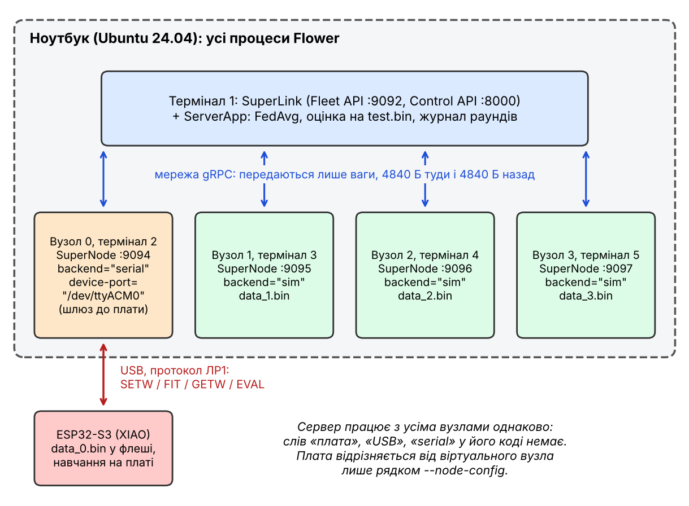

**Національний технічний університет України**
**«Київський політехнічний інститут ім. Ігоря Сікорського»**

Факультет інформатики та обчислювальної техніки
Кафедра обчислювальної техніки

**Лабораторна робота №2 з дисципліни**
**Розподілене та федеративне навчання**

| Перевірив | Виконав |
| --- | --- |
| Гордієнко Н.Ю. | студент ІВ-61мн Сташко Нікіта |

Київ – 2026

---

## Зміст

- 0. Використання LLM
- 1. Межі роботи і що змінилося відносно ЛР1
- 2. Схема системи
- 3. Реалізація
- 4. Експерименти
- 5. Результати
- 6. Який реальний сценарій найближчий до моєї системи
- 7. Таблиця відповідності вимогам
- 8. Відтворюваність
- 9. Журнал проблем
- 10. Відеозвіт
- 11. Висновок

---

# ЗВІТ З ЛАБОРАТОРНОЇ РОБОТИ №2

## ESP32 як рівноправний вузол федерації


## 0. Використання LLM

Під час виконання лабораторної роботи була використана LLM для допомоги з кодом (розділення серверної і клієнтської частин, скрипти запуску) та розбору помилок. Усі команди я виконував на своїй платі Seeed XIAO ESP32S3, а всі наведені у звіті числа отримано з моїх запусків.


## 1. Межі роботи і що змінилося відносно ЛР1

У ЛР1 усі клієнти Flower запускалися в одному процесі симуляції, а плата була в ній окремим випадком, який вибирався в коді. У ЛР2 система розгорнута так, як це робиться на практиці: сервер працює окремим процесом, кожен із чотирьох вузлів працює окремим процесом зі своїми даними, а вузли з'єднуються з сервером через мережу (gRPC, порт 9092). Один вузол обслуговує плату ESP32-S3, три інші симулюються на комп'ютері.

Модель (64 → 16 → 10, 1210 параметрів, 4840 байтів), дані, протокол «хост — плата» (INFO, SETW, FIT, GETW, EVAL) і прошивка з ЛР1 не змінювалися, плату не перепрошивали. Змінилося три речі: рішення «цей вузол — плата» тепер приймає сам вузол при запуску за своїм node_config; серверний код не має жодної згадки про плату; сервер вимірює точність окремо по кожному класу.

Таблиця 1. Відмінності ЛР2 від ЛР1

|  | ЛР1 | ЛР2 |
|-|-|-|
| Як запускаються клієнти | усі в одному процесі симуляції | кожен вузол окремим процесом (SuperNode) |
| Плата для сервера | окремий випадок у коді | звичайний вузол, як і решта |
| Що визначає роль вузла | код і run_config | node_config при запуску вузла |
| Головне питання | чи працює інфраструктура | що дає федерація окремому вузлу |

Версії: ESP-IDF v5.5.1, Python 3.12, Flower 1.43.0 (закріплено в ЛР1), numpy 2.2.6, pyserial 3.5. Платформа: Seeed XIAO ESP32S3, Ubuntu 24.04. Репозиторій: гілка lab2-fl від тегу lab1-fl, тег здачі lab2-fl, цей файл docs/lab2-report.md.


## 2. Схема системи

Запущено шість процесів у шести терміналах. Термінал 1: SuperLink, довготривалий серверний процес, який приймає підключення вузлів. Термінали 2–5: чотири SuperNode, по одному на вузол. Термінал 6: команда flwr run, яка передає SuperLink застосунок (ServerApp і ClientApp) і запускає прогін. Схему показано на рис. 1.



*Рис. 1. Архітектура федерації: сервер, чотири вузли, плата за шлюзом*

Таблиця 2. Процеси, порти і node_config

| Термінал | Процес | Порт | node_config (--node-config) |
|-|-|-|-|
| 1 | flower-superlink --insecure | 9092 (Fleet API), 8000 (Control API) | — |
| 2 | flower-supernode, вузол 0 (шлюз для плати) | 9094 | partition-id=0 backend="serial" device-port="/dev/ttyACM0" |
| 3 | flower-supernode, вузол 1 | 9095 | partition-id=1 backend="sim" data-path=".../data/data_1.bin" |
| 4 | flower-supernode, вузол 2 | 9096 | partition-id=2 backend="sim" data-path=".../data/data_2.bin" |
| 5 | flower-supernode, вузол 3 | 9097 | partition-id=3 backend="sim" data-path=".../data/data_3.bin" |
| 6 | flwr run host lab2 --stream | 8000 (до SuperLink) | — |

Порти 9094–9097 різні лише тому, що всі вузли працюють на одному комп'ютері. У реальному розгортанні кожен вузол стоїть на своїй машині з портом за замовчуванням. Шляхи data-path задано абсолютними, щоб вони не залежали від робочого каталога процесу, який запускає ClientApp.

Таблиця 3. Розподіл налаштувань між run_config і node_config

|  | run_config | node_config |
|-|-|-|
| Чиє | федерації, однакове для всіх вузлів | вузла, своє в кожного |
| Де задається | host/pyproject.toml, flwr run --run-config | flower-supernode --node-config |
| Що в ньому | seed, num-rounds, local-epochs, lr, batch, min-nodes, round-delay, repo-root, results-dir | partition-id, backend, device-port або data-path |
| Реальний аналог | правила навчання від компанії | що в конкретному телефоні чи шлюзі |

Плата відрізняється від віртуального вузла лише рядком node_config. Код ClientApp один і той самий, код ServerApp про різницю не знає.


## 3. Реалізація


### 3.1. Перевірка вхідних даних

Експерименти побудовані на тому, що у вузла 0 немає цифр 2, 5 і 8, тому використано оригінальні файли даних з додатка А ЛР1 без змін (скрипт make_data.py не застосовувався). Розміри файлів збігаються з очікуваними (таблиця 4).

Таблиця 4. Розміри файлів даних

| Файл | Розмір, байтів | Семплів | 20 + n·65 |
|-|-|-|-|
| data_0.bin | 9900 | 152 | 9900 |
| data_1.bin | 29140 | 448 | 29140 |
| data_2.bin | 29400 | 452 | 29400 |
| data_3.bin | 25110 | 386 | 25110 |
| test.bin | 23355 | 359 | 23355 |

Розмір файлу не доводить, що вміст той самий, тому додатково перевірено розподіл класів кожного файлу командою з методички (parse_data_file і numpy.bincount). Вивід для data_0.bin: [10 68 0 3 5 0 1 21 0 44], як і очікувалось. Результат для всіх файлів наведено в таблиці 5.

Таблиця 5. Розподіл класів у файлах даних (вивід bincount)

| Файл | 0 | 1 | 2 | 3 | 4 | 5 | 6 | 7 | 8 | 9 | Всього |
|-|-|-|-|-|-|-|-|-|-|-|-|
| data_0 (плата) | 10 | 68 | 0 | 3 | 5 | 0 | 1 | 21 | 0 | 44 | 152 |
| data_1 | 23 | 7 | 70 | 75 | 10 | 95 | 46 | 55 | 67 | 0 | 448 |
| data_2 | 91 | 62 | 71 | 1 | 10 | 40 | 96 | 48 | 0 | 33 | 452 |
| data_3 | 18 | 9 | 1 | 67 | 120 | 11 | 2 | 19 | 72 | 67 | 386 |
| test | 36 | 36 | 35 | 37 | 36 | 36 | 36 | 36 | 35 | 36 | 359 |

> **[ВСТАВИТИ РИСУНОК 2: скріншот термінала з виводом ls -l data/*.bin і виводом команди з bincount для файлів даних (команди з розділу 4.1 методички)]**

*Рис. 2. Перевірка файлів даних: розміри і розподіл класів*

Цифри 2, 5 і 8 у вузла 0 відсутні повністю, тому навчаючись сама плата не може їх розпізнавати. Цифри 3, 4 і 6 у неї майже відсутні (3, 5 і 1 приклад).


### 3.2. ClientApp: бекенд обирається за node_config

ClientApp читає з context.node_config три значення: partition-id, backend (serial або sim) і, залежно від бекенду, device-port або data-path. Параметри навчання (local-epochs, lr, batch, seed) він читає з context.run_config, однаково для всіх вузлів. Обидва бекенди мають однаковий інтерфейс train: отримати ваги, навчити, повернути нові ваги і метрики.

```
def make_backend(node: dict, run: dict):
    kind = str(node["backend"])
    if kind == "serial":
        port = str(node.get("device-port", ""))
        if not port:
            raise BoardUnavailable("backend=serial потребує device-port")
        transcript = RunLogs(run_dir(run)).transcript
        return BoardNode("serial", port, transcript)
    if kind == "sim":
        dp = node.get("data-path")
        if not dp:
            raise ValueError("backend=sim потребує data-path")
        path = resolve_path(str(dp), run["repo-root"])
        return VirtualClient(run["repo-root"], path=path)
    raise ValueError(f"невідомий backend: {kind}")
```

Якщо backend=serial, а плата недоступна, ClientApp завершується помилкою (BoardUnavailable), тихого переходу на симуляцію немає: він підробляв би результат. Помилку клієнта Flower перетворює на відповідь-помилку, і сервер бачить її як невдачу цього вузла (експеримент Г). ClientApp не зберігає стан між раундами: SuperNode запускає його заново на кожне повідомлення, тому сервер щоразу надсилає повні ваги, а клієнт для плати щоразу відкриває порт. Відкриття порту не перезавантажує плату, бо в SerialTransport лінії DTR і RTS встановлюються в True ще до open (виправлення з ЛР1, коміт 0599c63).


### 3.3. ServerApp: сервер не знає про плату

Серверний код винесено в окремий модуль serverlib.py (журнали раундів, оцінка на test.bin, FedAvg), який не імпортує ні протокол плати, ні послідовний транспорт. Раніше ці допоміжні функції лежали в fedlib.py разом з класами плати, тому навіть імпорт серверу тягнув би pyserial. Тепер server_app.py залежить лише від serverlib.py і fl_model_ref.py. Перевірка пошуком по файлах сервера (make check-server):

```
$ grep -nwiE 'serial|port|backend|board|protocol|transports' \
    host/fl_lab/server_app.py host/fl_lab/serverlib.py
$ echo $?
1
```

Результат порожній (код виходу 1 означає, що збігів немає): у коді сервера немає жодної згадки про плату, порт чи бекенд.

> **[ВСТАВИТИ РИСУНОК 3: скріншот виводу make check-server на моїй машині, рядок «(порожньо): серверний код не згадує плату»]**

*Рис. 3. Пошук слів serial, port, backend у коді сервера: збігів немає*

Сервер чекає на всі вузли перед першим раундом: у [tool.flwr.app.config] у pyproject.toml додано ключ min-nodes = 4, який передається в стратегію як min_train_nodes і min_available_nodes. Без цього раунд міг би початися, коли підключилися не всі вузли. Ключ задано саме в pyproject.toml, бо --run-config лише перевизначає наявні ключі. Також додано ключ round-delay: пауза в секундах після кожного раунду (за замовчуванням 0), яка потрібна лише в експерименті Г, щоб устигнути вийняти кабель між раундами (раунд із платою триває близько секунди).

Для кроку 2 до серверної оцінки на test.bin додано точність окремо для кожного класу. Це зміна лише в обчисленні метрики (функція class_accuracy у serverlib.py): агрегація і протокол не змінювалися. Десять чисел записуються в журнал rounds.jsonl (поле class_acc) і виводяться в журнал сервера в кожному раунді. Фінальна глобальна модель зберігається у results/<прогін>/final_weights.bin для кроку «повернення моделі на пристрій».


### 3.4. Підключення flwr run до SuperLink

Шлях до файла конфігурації Flower показала команда flwr config list. До нього додано з'єднання:

```
[superlink.lab2]
address = "127.0.0.1:8000"
insecure = true
```

> **[ВСТАВИТИ РИСУНОК 4: скріншот виводу flwr config list і вмісту секції [superlink.lab2] у файлі конфігурації]**

*Рис. 4. Конфігурація flwr: шлях до файла і секція [superlink.lab2]*


## 4. Експерименти

Усі експерименти виконано з однаковими параметрами: seed = 1, 10 раундів, 3 локальні епохи, lr = 0.3, batch = 16. Перед кожним прогоном з платою її приведено до холодного старту командою RESET (make board-reset), щоб лічильники й порядок даних на платі не залежали від попереднього прогону. Кожен прогін пише у власний каталог results/exp-*, а сервер відмовляється запускатися в непорожньому каталозі.


### 4.0. Крок 0: перевірка стану після ЛР1

Підключено плату і виконано скрипт одного раунду з ЛР1 (make one-round: INFO, SETW, FIT, GETW, EVAL).

> **[ВСТАВИТИ РИСУНОК 5: скріншот виводу make one-round без помилок; INFO показує n=152 (train=122, val=30); контрольна сума ваг після INIT 1 дорівнює f8692cac]**

*Рис. 5. Крок 0: один раунд з платою працює, 152 семпли, CRC f8692cac*


### 4.1. Запуск федерації (крок 3)

Запущено SuperLink і чотири SuperNode (make superlink, make node0 PORT=/dev/ttyACM0, make node1, make node2, make node3). Прогін запущено командою flwr run host lab2 --stream з параметрами через make flwr-run.

> **[ВСТАВИТИ РИСУНОК 6: скріншот шести терміналів: SuperLink, чотири SuperNode і flwr run]**

*Рис. 6. Шість терміналів: сервер, чотири вузли, flwr run*

> **[ВСТАВИТИ РИСУНОК 7: фрагмент журналу сервера: у кожному раунді рядок на зразок «received 4 results and 0 failures» і десять точностей по класах]**

*Рис. 7. Журнал сервера в експерименті Б: чотири результати і нуль помилок у кожному раунді*


### 4.2. Експеримент А: плата навчається сама

Залишено запущеними лише SuperLink і SuperNode 0 (плата). Прогін з одним вузлом: make flwr-run EXP=exp-a MIN=1. FedAvg над одним клієнтом повертає оновлення цього клієнта без змін, тому 10 раундів по 3 епохи це те саме, що 30 епох локального навчання на платі. Це нижня межа: що плата вміє без федерації.

> **[ВСТАВИТИ РИСУНОК 8: фрагмент журналу сервера прогону exp-a з точністю по класах (класи 2, 5, 8 мають бути 0.00)]**

*Рис. 8. Журнал сервера в експерименті А: точність по класах*

> **[ЗАПИСАТИ в таблицю 6: загальну точність на test.bin і точність по класах з results/exp-a/rounds.jsonl (останній раунд)]**


### 4.3. Експеримент Б: плата у федерації

Запущено всі чотири вузли і прогін з тими самими параметрами: make flwr-run EXP=exp-b MIN=4. Після прогону лічильники плати прочитано командою make board-read EXP=exp-b, а фінальну глобальну модель повернуто на плату: make board-global WEIGHTS=results/exp-b/final_weights.bin (SETW, EVAL, GETW, перевірка ваг на тесті). Те саме виконано для ваг експерименту А.

> **[ЗАПИСАТИ в таблицю 6: загальну точність і точність по класах 2, 5, 8 з results/exp-b/rounds.jsonl; динаміку точності по раундах взяти з журналу сервера (рис. 7)]**


### 4.4. Експеримент В: заміна плати віртуальним вузлом

SuperNode 0 зупинено і запущено знову зі зміною лише node_config: backend="sim" data-path=".../data/data_0.bin" (make node0-sim). Той самий прогін, що в експерименті Б: make flwr-run EXP=exp-c MIN=4. Сервер, ClientApp і решта вузлів не змінювалися.

> **[ВСТАВИТИ РИСУНОК 9: фрагмент журналу по клієнтах (clients.jsonl, поле ms для client=0) прогонів exp-b і exp-c, видно різницю в часі навчання вузла 0]**

*Рис. 9. Експеримент В: час навчання вузла 0 на платі і на ПК*

> **[ЗАПИСАТИ в таблицю 6: результат експерименту В (точність, класи 2/5/8) і порівняння з Б; різницю часу навчання вузла 0 між платою і ПК (має бути близько двох порядків)]**


### 4.5. Експеримент Г: від'єднання плати посеред прогону

Вузол 0 повернуто на плату (make node0 PORT=/dev/ttyACM0), плату скинуто (make board-reset). Прогін на 10 раундів з паузою після кожного раунду: make flwr-run EXP=exp-g DELAY=10.0. Після появи в журналі сервера рядка «пауза 10 с після раунду 3» USB-кабель плати від'єднано.

> **[ВСТАВИТИ РИСУНОК 10: фрагмент журналу сервера з раунду, де плату від'єднали (3 results і 1 failure), і наступних раундів]**

*Рис. 10. Журнал сервера в експерименті Г: раунд, де плату від'єднали (3 результати, 1 помилка)*


## 5. Результати

Таблиця 6. Експерименти (всі числа з моїх запусків; заповнити після виконання)

| Експеримент | Вузлів | Загальна точність | Клас 2 | Клас 5 | Клас 8 | Байтів за прогін |
|-|-|-|-|-|-|-|
| А. плата сама | 1 | […] | […] | […] | […] | […] |
| Б. федерація | 4 | […] | […] | […] | […] | […] |
| В. вузол 0 на ПК | 4 | […] | […] | […] | […] | […] |
| Г. плата від'єднана | 4 → 3 | […] | […] | […] | […] | […] |

> **[ЗАПОВНИТИ таблицю 6 виводом make lab2-table (числа беруться з results/exp-*/rounds.jsonl і clients.jsonl); байтів за прогін = сума rx_bytes + tx_bytes успішних клієнтів, для плати додатково порівняти з лічильниками STATS у results/exp-*/board_stats.json]**

> **[ВСТАВИТИ РИСУНОК 11: графік results/lab2-accuracy.png, точність на test.bin по раундах для А, Б і Г на одних осях (make lab2-plot)]**

*Рис. 11. Точність на test.bin по раундах: А, Б і Г*

> **[ВСТАВИТИ РИСУНОК 12: графік results/lab2-classes.png, точність по класах у А і Б]**

*Рис. 12. Точність по класах у кінці прогону: А і Б*

Таблиця 7. Точність плати після завантаження глобальної моделі

| Ваги на платі | EVAL на платі (локальна валідація, 30 семплів) | Точність ваг з плати на test.bin | Класи 2 / 5 / 8 |
|-|-|-|-|
| після А (власні) | […] | […] | […] |
| після Б (глобальна) | […] | […] | […] |

> **[ВСТАВИТИ РИСУНОК 13: скріншот виводу make board-global для ваг експерименту Б (roundtrip_identical = true, точність на test.bin)]**

*Рис. 13. Завантаження глобальної моделі на плату: SETW, EVAL, GETW*

Пояснення до таблиці 7: команда EVAL на платі рахує точність на власній валідаційній частині даних плати (30 семплів, у них немає цифр 2, 5, 8), тому вона майже не відрізняє модель після А від моделі після Б. Щоб побачити, чи знає плата всі класи, ваги, які плата тримає після SETW, зчитано назад командою GETW (збіг з надісланими перевірено) і оцінено на test.bin, якого не бачив жоден вузол.

> **[ВСТАВИТИ: висновки по числах: що змінилось між А і Б для класів 2, 5, 8; чи близькі Б і В; що сталося в Г; чи змінилась точність по класах після втрати вузла 0 і чому (вузол 0 має 152 з 1438 семплів, 10.6 %)]**


## 6. Який реальний сценарій найближчий до моєї системи

Найближчий сценарій з розділу 2 методички це промисловий IoT. Мікроконтролер датчика, як і моя плата ESP32-S3, не вміє сам брати участь у мережевому протоколі федерації: у нього є лише послідовний канал. Тому біля нього стоїть шлюз, який підключається до сервера від його імені. У моїй системі цю роль виконує процес SuperNode вузла 0 на комп'ютері: він приймає ваги з мережі, передає їх на плату командою SETW, запускає навчання командою FIT, забирає результат командою GETW і повертає його серверу. Плата для сервера нічим не відрізняється від віртуальних вузлів, а тому її можна замінити на ПК одним рядком запуску (експеримент В).

Щоб ця система працювала на тисячах пристроїв, довелося б додати кілька речей. По-перше, відбір пристроїв: сервер не може чекати на всіх (min-nodes = 4 замінюється на частку учасників і таймаут раунду), а пристрої мають брати участь за умов, як у Gboard (заряджання, мережа, простій). По-друге, безпеку: з'єднання з параметром --insecure треба замінити на TLS з автентифікацією вузлів, бо ваги можуть розкривати інформацію про дані, і їх варто захищати (безпечна агрегація, кліпінг, шум). По-третє, керування парком: оновлення прошивки й даних на пристроях, моніторинг, облік версій моделі. По-четверте, масштабування самого сервера і каналу: 4840 байтів на раунд це мало для Wi-Fi, але для LoRa чи NB-IoT це вже обмеження, тому потрібне стиснення оновлень і рідші раунди.

> **[ПЕРЕПИСАТИ СВОЇМИ СЛОВАМИ перед здачею: методичка вимагає відповідь «своїми словами» (пів сторінки); цей текст є чернеткою]**


## 7. Таблиця відповідності вимогам

Таблиця 8. Кроки методички і докази

| Крок | Що зроблено | Де доказ |
|-|-|-|
| 0 | перевірка стану після ЛР1 | розділ 4.0, рис. 5 |
| 1 | ClientApp обирає бекенд за node_config; ServerApp без згадок про плату | розділи 3.2, 3.3, рис. 3 |
| 2 | точність по класах у серверній оцінці | розділ 3.3, рис. 7 |
| 3 | SuperLink і чотири SuperNode, min-nodes = 4 | розділи 2, 4.1, рис. 1, 6, 7 |
| 4 | експеримент А: плата сама | розділ 4.2, рис. 8, таблиця 6 |
| 5 | експеримент Б: плата у федерації; модель повернено на плату | розділ 4.3, рис. 11–13, таблиці 6, 7 |
| 6 | експеримент В: плата замінена віртуальним вузлом | розділ 4.4, рис. 9, таблиця 6 |
| 7 | експеримент Г: від'єднання плати посеред прогону | розділ 4.5, рис. 10, 11, таблиця 6 |


## 8. Відтворюваність

Усі команди виконуються з кореня репозиторію (гілка lab2-fl). Дані оригінальні, версії закріплено (Flower 1.43.0). Параметр PORT за замовчуванням /dev/ttyACM0.

```
make venv
make check-server

# термінал 1
make superlink
# термінали 2-5
make node0 PORT=/dev/ttyACM0
make node1
make node2
make node3

# термінал 6: експеримент Б
make board-reset PORT=/dev/ttyACM0
make flwr-run EXP=exp-b MIN=4
make board-read EXP=exp-b PORT=/dev/ttyACM0
make board-global WEIGHTS=results/exp-b/final_weights.bin PORT=/dev/ttyACM0

# експеримент А (залишити тільки SuperLink і вузол 0)
make board-reset PORT=/dev/ttyACM0
make flwr-run EXP=exp-a MIN=1
make board-read EXP=exp-a PORT=/dev/ttyACM0
make board-global WEIGHTS=results/exp-a/final_weights.bin PORT=/dev/ttyACM0

# експеримент В (вузол 0 перезапущено як make node0-sim)
make flwr-run EXP=exp-c MIN=4

# експеримент Г (вузол 0 знову на платі)
make board-reset PORT=/dev/ttyACM0
make flwr-run EXP=exp-g MIN=4 DELAY=10.0

make lab2-table
make lab2-plot
```


## 9. Журнал проблем

Формат: симптом → справжня причина → виправлення.

Таблиця 9. Журнал проблем

| № | Симптом | Справжня причина | Виправлення |
|-|-|-|-|
| 1 | […] | […] | […] |

> **[ЗАПОВНЮВАТИ по ходу роботи: кожну помилку, яка зустрілась (команда, текст помилки, що виявилось причиною, що виправлено)]**


## 10. Відеозвіт

> **[ДОДАТИ посилання або назву файла відео (1–2 хв): шість терміналів на екрані (сервер, чотири вузли, flwr run), видно федерацію, в якій вузол 0 це плата, і момент від'єднання кабелю]**


## 11. Висновок

> **[НАПИСАТИ наприкінці, коли будуть числа: що реалізовано (кроки 0–7), точність А і Б, чи рівноправна плата (В), що сталося при від'єднанні (Г)]**
